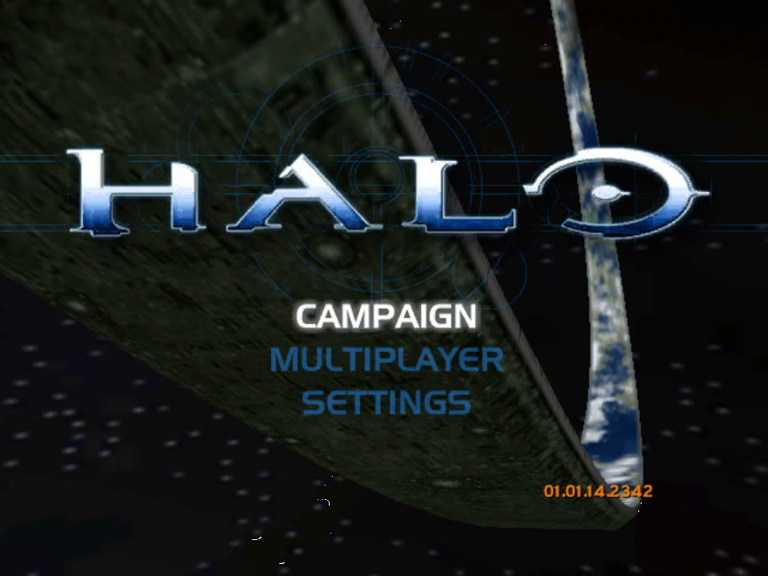
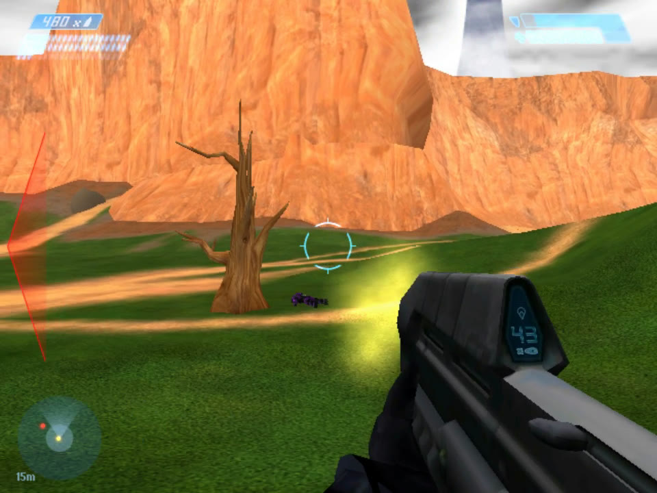
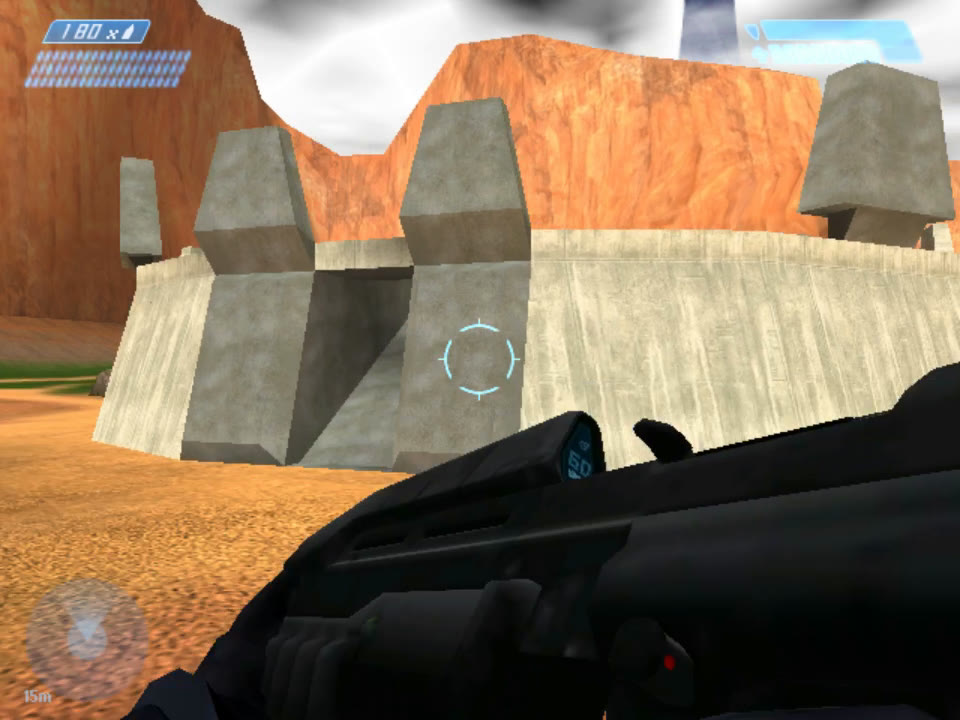
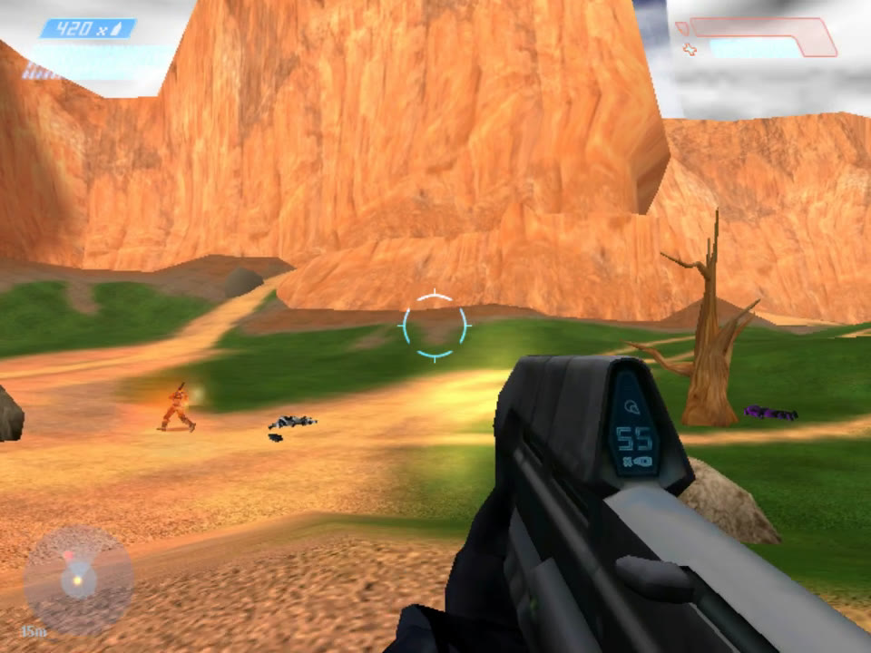
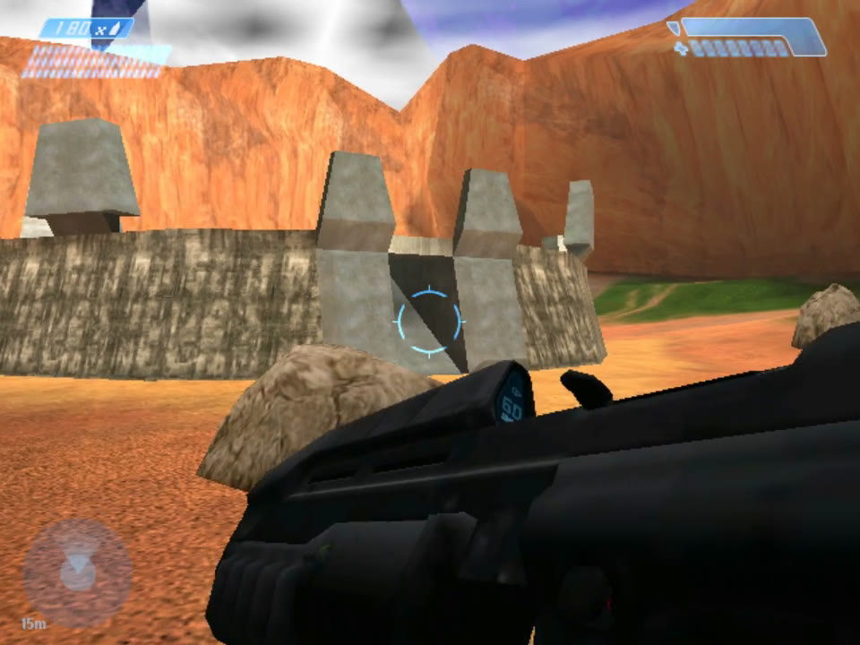
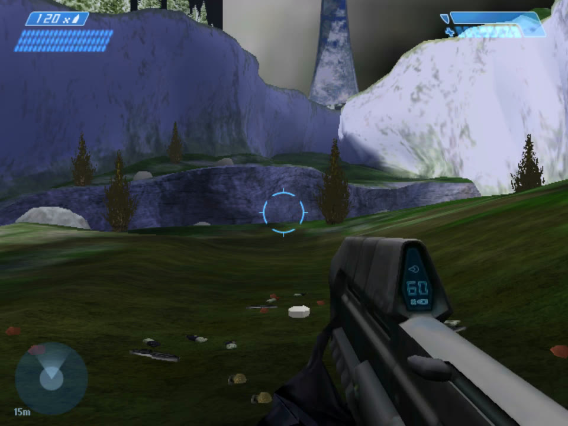
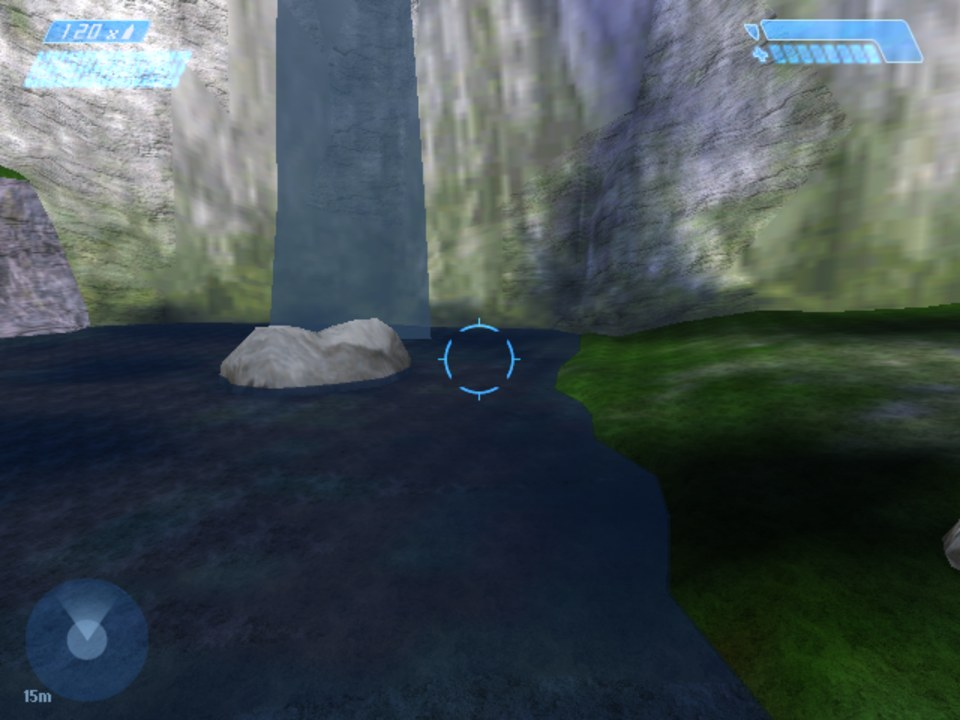

# Halo: Combat Evolved on the Sega Dreamcast

Halo: Combat Evolved's own game code running on a Sega Dreamcast: Halo's real Xbox menus, Blood Gulch multiplayer with bots, and the campaign level "Halo" (a30).
It runs at a steady 30 fps.

| | |
|---|---|
|  |  |
| Blood Gulch: Halo's sky, haze and terrain detail | Halo's HUD, kill messages, bots |
|  |  |
| The assault rifle's ammo counter on the gun | Slayer against bots |
|  |  |
| The campaign: "Halo" (a30) | Its river and waterfall |

Screenshots taken in the Flycast emulator.

> **You need your own copy of the Xbox game.** Nothing from the retail game is in this repository.
> The build converts the maps from your own disc image.
> A disc image you build contains converted game data: keep it to yourself.

## What works

- **Halo's own menus**, the Xbox's shell running on the Dreamcast:
  - the boot intro, the main menu over the ring
  - profiles with the virtual keyboard
  - the game type editor
  - split-screen join, map and game type select, the pregame lobby
- **Blood Gulch multiplayer:**
  - up to four players on the Dreamcast's pads, plus bots
  - Slayer, CTF and Halo's other game types
  - vehicles, every weapon
  - Halo's HUD and sounds on the Dreamcast's sound chip
  - the pause menu with scores
- **The campaign level "Halo" (a30)**, started from Halo's CAMPAIGN menu with a difficulty choice:
  - its squads placed as you go, simplified Covenant and Marine AI, checkpoints
  - not yet: Halo's scripts, cutscenes and the level's second half
- **The look:**
  - Halo's lightmaps and its sky model with haze
  - terrain and cliff detail maps
  - weapon displays: the assault rifle's counter and compass, the plasma weapons' heat gauges
  - self-illuminated lights, water
  - soft shadows, particles and explosions
- **30 fps**, paced by the display. Draw and game time are measured on screen and over the serial port.

Developed and tested in Flycast. Earlier builds ran on a real Dreamcast from a GDEMU; the latest builds are not yet tested on hardware.

## Building

On Windows:

1. **DreamSDK R4** at `C:\DreamSDK`, with KallistiOS 2.2.2 built in `C:\DreamSDK\opt\toolchains\dc\kos`.
   Build KallistiOS's VQ texture encoder once:
   `C:\DreamSDK\usr\bin\bash.exe engine\tools\dc_build_pvrtex.sh`
2. **Python 3** with Pillow, and **ninja** on the PATH.
3. **Invader's tag definitions** (read at conversion time):
   `git clone --depth 1 https://github.com/SnowyMouse/invader engine\dependencies\invader`
4. **ffmpeg** (for the boot intro) at `C:\Tools\ffmpeg\<version>\bin\ffmpeg.exe`, or set `FFMPEG`.
5. Build with your own Halo: Combat Evolved Xbox disc image:

       build-halo-dc.bat "D:\Games\Halo.iso"
       build-halo-dc-campaign.bat "D:\Games\Halo.iso"

   The first makes `engine\build\dc\disc\halo.cdi` (multiplayer).
   The second makes `engine\build\dc-campaign\disc\halo.cdi` (the campaign; build the multiplayer disc first).
6. Play it in Flycast (`run-halo-dc.bat` expects `C:\Tools\flycast`), or put the `.cdi` on a GDEMU or other optical drive emulator's SD card.

The Dreamcast port's own notes are `engine\port\dc\README.md`.

## How it works

- The game code is the decompiled source of Halo: Combat Evolved (the Xbox build 2342), by way of the [Nintendo 64 port "halo-64"](https://github.com/JackTulli/halo-64).
  That port cut the game down to fit a small console and defined a platform interface, `n64.h`.
- This project implements that interface for the Dreamcast on KallistiOS (`engine/port/dc`):
  - a PowerVR renderer for the level, models, sky, HUD, particles and shadows
  - the AICA for sound
  - the Dreamcast pads, the disc and frame pacing
- Halo's own Xbox menus run on top, through a local stand-in for the Xbox's network lobby.
- The maps are converted from the Xbox's cache files by Python tools (`engine/tools/n64`, with `--dc`).

## Credits

- The Halo decompilation projects this code descends from: punpckhdq/halo, bnunu/halo-1, OpenCE, and halo-ce-universal.
- [halo-64](https://github.com/JackTulli/halo-64), the Nintendo 64 port this is built on (CC0).
- [KallistiOS](https://github.com/KallistiOS/KallistiOS) and [DreamSDK](https://dreamsdk.org).
- [Invader](https://github.com/SnowyMouse/invader)'s tag definitions (GPL-3; read at build time, not included).
- [Flycast](https://github.com/flyinghead/flycast), used for testing.

## Legal

This is a fan project for preservation and education. It isn't affiliated with or endorsed by Microsoft, Bungie, Halo Studios or Sega.
Halo is a trademark of Microsoft.
No game assets are included or distributed: you need your own copy of the game.
The port's own code follows the [CC0 dedication](engine/LICENSE.md) of the project it builds on.
